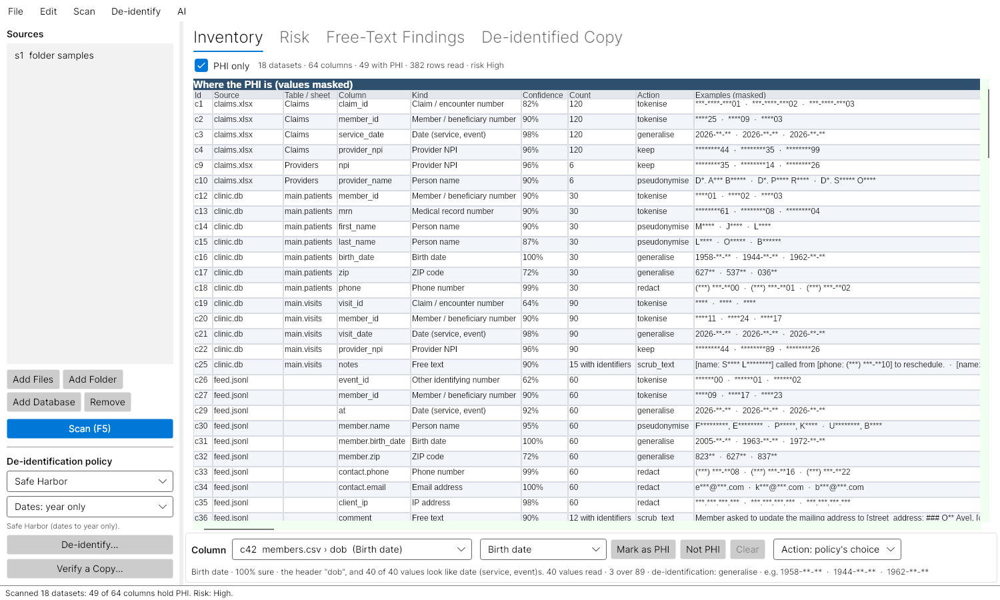
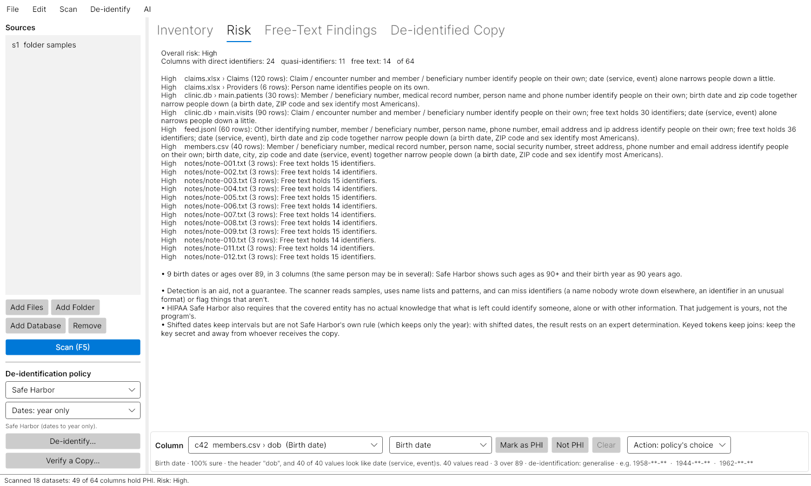
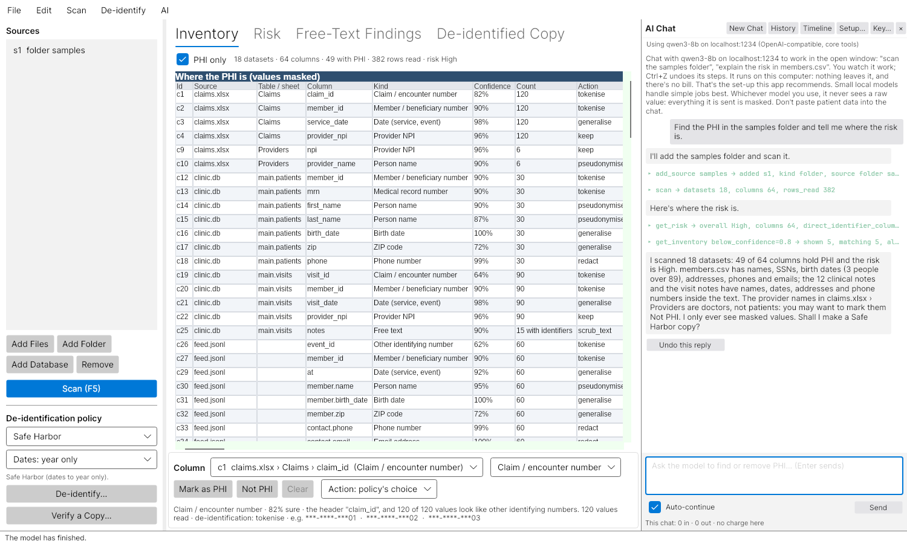

# AVA PHI Scanner

Finds protected health information (PHI) and personal data in files and databases, reports where it is, and writes a
de-identified copy in which joins and totals still work. Built with .NET 10 and [Avalonia UI](https://avaloniaui.net/);
runs on Windows, macOS and Linux.

A safe first AI pilot on healthcare data starts by knowing where the PHI is and taking the identifiers out. AVA PHI
Scanner does both: point it at a folder of extracts or a database, read the inventory (which columns hold names, SSNs,
member IDs, dates, addresses; what's hidden in the free-text notes; how risky each table is), correct what it got wrong,
choose a policy (HIPAA Safe Harbor, a limited data set, or your own per-column choices) and write a copy. Member IDs
become keyed tokens, so the same member is the same token in every file and table and the copy still joins; dates keep
only their year (or, if you need intervals, each person's dates move by the same number of days); amounts and clinical
values are copied as they are, so totals still balance. Then it re-scans the copy and tells you what, if anything, is left.

It also has an **AI Chat** (F12) and an **MCP server**, so Claude or a model on your own computer can do the same work in
the window. **Agents never see a raw value**: everything they are sent is masked, and nothing turns that off. See
[AI: the chat and agents](#ai-the-chat-and-agents).

> **Detection is an aid, not a guarantee.** The scanner reads samples, uses name lists and patterns, and can miss an
> identifier (a name nobody wrote down anywhere else, a number in an unusual format) or flag something that isn't one.
> Review the inventory, read some of the copy, and keep a person responsible for what leaves. HIPAA Safe Harbor also
> requires that you have **no actual knowledge** that what is left could identify someone, alone or with other
> information: that judgement is yours, not the program's.



## Download

Builds for Windows, macOS and Linux (Intel/AMD and ARM) are on the
[latest release](https://github.com/Harlock123/AVAPHIScanner/releases/tag/latest). Unzip or untar and run
`AVAPHIScanner` (`AVAPHIScanner.exe` on Windows); nothing else needs installing.

## What it reads

- **Files**: CSV and TSV, Excel workbooks (.xlsx, every sheet), JSON (an array of records, or an object holding one)
  and JSON lines, and plain text (clinical notes, letters, logs).
- **Folders** of any of those, read through their sub-folders. SQLite files found in a folder are read as databases.
- **Databases**: tables in SQL Server, PostgreSQL and SQLite, all of them or the ones you name. A database is only ever
  read: SQLite opens read-only, and every read is inside a transaction that is rolled back (read-only on PostgreSQL).

Big tables are sampled: a scan reads the first 10,000 rows of each table (Scan › Sample Rows changes it), and says so.
De-identification always reads every row.

## What it finds

The 18 identifiers of HIPAA's Safe Harbor method (45 CFR §164.514(b)(2)), and provider NPIs:

| Kind | How it's found |
|---|---|
| Names | First- and last-name frequency lists bundled with the program, header hints (`last_name`, `PatientName`…); in text, after a title (Mr., Dr., Patient), first-and-last pairs, "Last, First", and any name the scan found in a name column |
| Street addresses, cities, ZIP codes | Address patterns (number, street, suffix, unit; PO boxes), a list of US cities, ZIP and ZIP+4 by header, after a state in text |
| Dates | Birth, admission, service, discharge and other dates in 25 formats (ISO, US, `14-Mar-1957`, `March 14, 1957`, `yyyyMMdd`, with times; typed dates in workbooks and databases); birth dates by header, or by what's written before them in text |
| Ages over 89 | Age columns, birth dates, and "92-year-old", "aged 96" in text |
| Phone and fax numbers | North American numbering rules (no area code or exchange starting 0 or 1); fax by header or by "fax" before it |
| Email, web addresses, IP addresses | Patterns, with IPv4 octets checked and IPv6 parsed |
| SSNs | Dashed or spaced, with the SSA's rules: no area 000, 666 or 900-999, no group 00, no serial 0000, not the famous invalid ones. Area 900-999 written the same way counts too: an ITIN (a taxpayer number) or an example number standing in for an SSN. Nine bare digits count only weakly, and only when they pass the SSA's rules, so a column of nine-digit claim numbers stays claim numbers |
| Medical record, member, account and claim numbers | Header hints, labels in text ("MRN:", "Member ID"), identifiers the scan found in ID columns, Medicare MBIs by their pattern, payment cards by issuer and Luhn check |
| Licence and certificate numbers | Header hints, labels; DEA numbers by their checksum |
| Vehicle and device identifiers | VINs by their check digit, IMEIs by Luhn, serial/UDI headers |
| Biometrics and photos | References to image, audio and biometric files (`.jpg`, `.dcm`, `.wav`, `.wsq`…) |
| Provider NPIs | Ten digits whose check digit passes Luhn with the 80840 prefix: reported, and kept by default (a provider's, not the patient's) |

Each **column** is classified from its header and a sample of its values, with a **confidence** and the reason
("the header "dob", and 40 of 40 values look like dates"). Long text is **free text**: each cell is scanned and every
identifier found in it is listed, cell by cell. A short text column that turns out to hold identifiers is treated as
free text too.

## The report

- **Inventory**: source › table or sheet › column, the kind, the confidence, how many values, masked examples
  ("J*** S****", "***-**-1234", "1957-**-**") and what de-identification will do with it.
- **Risk**: each table High (direct identifiers, or identifiers in free text), Medium (two or more quasi-identifiers,
  such as a birth date and a ZIP code, which together identify most Americans) or Low, and why; people over 89;
  sampled tables; low-confidence columns to check.
- **Free-text findings**: every identifier found in text, by column and row, masked.
- **Export** to Excel (.xlsx: summary, inventory, findings and the last verification) or a web page (.html). Every
  value in a report is masked.

When the scan is wrong, choose the column and say so: **Mark as PHI** (with its kind) or **Not PHI**. Decisions stay
with the project, survive a rescan, and are undo steps like everything else (Ctrl+Z).



## De-identifying

Choose a policy, then **De-identify…**: an output folder of its own (never inside a source folder: the program refuses)
and a key file. The copy has the same files as the sources, in the same formats: CSV stays CSV, a workbook stays a
workbook (typed dates stay dates), JSON keeps its shape, a SQLite database becomes a SQLite database, and a server's
tables become CSV files or one SQLite database.

**Safe Harbor** (the default):

| Kind | Becomes |
|---|---|
| Names | Made-up names, word by word, keeping their shape ("Lopez, Maria" → "Talbot, Quinn"; "Dr." and "Jr." stay) |
| SSNs, MRNs, member, account, claim, licence, vehicle and device numbers | Keyed tokens `ID-XXXXXXXXXX`: the same value always gets the same token, in every file, table and run with the same key, so joins still work |
| Dates | Just the year (**Dates: year only**, the default); or, with **Dates: shifted per person**, moved back 1 to 365 days, the same number for every date of the same person (by member ID, else MRN, else SSN), so intervals stay true |
| Birth dates over 89 years ago | 1 January of the year 90 years ago |
| ZIP codes | The first three digits; `000` for the 17 three-digit areas of 20,000 people or fewer (the HHS list is bundled) |
| Ages over 89 | `90+` |
| Phone, fax, email, web and IP addresses, street addresses, cities, photo references | Markers: `[PHONE]`, `[EMAIL]`, `[ADDRESS]`… |
| Free text | Each identifier found in it replaced where it stands, the same way |
| Amounts, codes, clinical values | Copied as they are: totals balance |

**Limited Data Set** (§164.514(e), for research under a data use agreement): direct identifiers go the same way, but
dates, cities, states, ZIP codes and ages are kept. A limited data set is not de-identified data.

**Custom**: Safe Harbor's choices, with your own action for chosen columns: keep, drop, pseudonymise, tokenise, shift
date, generalise (dates to the year, ZIP codes to three digits, ages over 89 to 90+) or redact.

**The key file** (32 random bytes) is what tokens, made-up names and date shifts are made from. Keep it: the same key
gives the same tokens next month, so months join. Never send it with the copy; whoever has it and the original data
can work out which token is whose. Two things to know:

- **Dates keep only their year by default**, Safe Harbor's own rule. **Dates: shifted per person** keeps intervals
  (lengths of stay, days between visits) but goes beyond that rule: a copy with shifted dates rests on an expert
  determination.
- **Keyed tokens are derived from the identifiers.** HHS's guidance (§164.514(c)) is careful about re-identification
  codes derived from identifiers: keep the key secret and away from recipients, and have the method reviewed if in doubt.

**Verify** re-scans the copy: every value the policy removes that is still there is reported, masked, by place, as is
any original value from the sources (it checks for the values the source scan saw, not just their look), with a
before/after count by kind. Under the year-only rule a full date left in is reported; with shifted dates, dates are
counted as kept by the policy.

## Projects

Sources, decisions and the policy are saved as a `.phiscan` project (JSON), with paths relative to the project file.
A project names saved database connections by name; a connection string typed in is kept with any password in it, so
keep project files private. Scan results aren't saved: scan again after opening.

## Command line

```bash
AVAPHIScanner --scan samples --report inventory.xlsx
AVAPHIScanner --scan sqlite:samples/clinic.db --report clinic.html
AVAPHIScanner --deidentify samples --policy safe-harbor --key-file keys/phi.key --out deidentified
AVAPHIScanner --deidentify project.phiscan --dates shift --key-file keys/phi.key --out deidentified --report check.html
AVAPHIScanner --verify deidentified --against samples
```

A source is a file, a folder, a project, or a database (`sqlite:PATH`, `sqlserver:"CONNECTION STRING"`,
`postgres:"CONNECTION STRING"`). `--deidentify` makes the key file if it doesn't exist, writes the copy, verifies it and
exits 0 only if the copy is clean; `--verify` exits 1 if anything is left. Nothing the command line prints is a raw
value. `AVAPHIScanner --help` lists the options.

## AI: the chat and agents



**The AI Chat** (F12, or AI › AI Chat) docks on the right. Ask it to find the PHI in a folder, explain the risk in a
table, or make a Safe Harbor copy for a vendor and check it. Each step shows in the panel as it happens and is one undo
step (Ctrl+Z takes it back), and **Undo this reply** takes back a whole answer. The **Timeline** lists each reply that
changed the project, with the inventory as it was before it. **History** keeps past chats if you tick Keep chat history.

Setup… chooses the model, through either of two APIs:

- **Anthropic API**: Claude, with your Anthropic API key (Key…, or the `ANTHROPIC_API_KEY` environment variable). Or
  give **Server** the address of a model server on this computer or your network that speaks the same API, such as
  **LM Studio** (`http://localhost:1234`) or **Ollama** (`http://localhost:11434`), and the model's name there.
- **OpenAI-compatible**: LM Studio (`http://localhost:1234/v1`), Ollama (`http://localhost:11434/v1`), vLLM,
  llama.cpp, a server elsewhere on your network, OpenAI or another cloud service, or a company gateway.

**A model on your own computer is recommended for this app.** Agents never see a raw value, but the inventory (file,
table and column names, kinds and counts) still describes your data; a local model sends nothing anywhere and costs
nothing. For a small local model, tick **Core tools only** (16 tools in place of 33). Claude's use is counted as it
goes, with an estimated cost per chat, daily and monthly totals, and an optional budget (Setup…).

**Agents never see a raw value, and no option changes that.** Every value a tool answers with is masked where it is
made: names to initials, identifiers to their last characters where the kind allows, dates to their year, values that
aren't PHI to their shape (`999.99`), free text with its identifiers and every unusual capitalised word or number
masked, so a name the detectors missed still doesn't get through. File names that may hold a name are masked too (with a
reference to use instead). Then every answer passes a last guard on its way out of the server, which masks any value a
scan has seen and anything shaped like an SSN, email address, phone number or full date. There is no tool that reads a
file. The tests call every tool over the samples, run every recipe and a chat, and search every answer, the chat's
transcript and every request sent to the model for the samples' names, SSNs, MRNs, member IDs, phone numbers, emails,
addresses and birth dates. Don't paste patient data into the chat: what you type does go to the model.

**Agents outside the program.** Claude Code, Claude Desktop or any MCP client can work in the open window: turn on
AI › Allow AI Agents (MCP), then add the server, for Claude Code:

```bash
claude mcp add avaphiscanner -- /path/to/AVAPHIScanner --mcp --attach
```

Without `--attach`, `AVAPHIScanner --mcp` is a server with a project of its own and no window (`--root FOLDER` sets its
working folder). AI › Connect an Agent also opens a network door (MCP over HTTP, port 8775, with an access token;
`AVAPHISCANNER_MCP_TOKEN` can give it) for agents on other computers; `AVAPHISCANNER_MCP_PIPE` names another pipe for
the local door. `AVAPHIScanner --mcp --help` lists the options.

**The tools** (33): the project (`get_project`, `new_project`, `open_project`, `save_project`); sources (`list_files`,
`list_connections`, `add_connection`, `add_source`, `remove_source`, `set_sampling`); the scan (`scan`,
`get_inventory`, `get_column`, `get_risk`); decisions and policy (`set_classification`, `clear_classification`,
`set_policy`, `set_column_action`); de-identifying (`preview_deidentification`, `deidentify`, `verify`); the report and a
picture of the inventory (`export_report`, `render_view`); undo and redo; and for longer work `batch` (several changes as
one undo step, or a dry run), checkpoints with `diff`, `render_checkpoint` and `restore_checkpoint`, and steps files
(`get_recording`, `save_steps`, `run_steps`) that rerun a set-up with new values, such as next month's folder.

**Recipes** (MCP prompts): find the PHI in a folder, inventory a database, de-identify for a vendor (Safe Harbor), a
limited data set for research, check that an export is clean, explain the risk in a table, review free-text notes, and a
repeatable monthly de-identification.

**Try it** on `samples/`: a made-up health plan's members (`members.csv`), claims and providers (`claims.xlsx`), twelve
clinical notes (`notes/`), an eligibility and contact feed (`feed.jsonl`) and a small clinic database (`clinic.db`), all
sharing member IDs so the copy's joins can be checked. Every person, number and note is invented: phone numbers are in
the 555-0100 to 555-0199 range kept for fiction, emails at example.com, IP addresses in 192.0.2.0/24, SSNs in
9xx-01…49 (never issued, as an SSN or an ITIN, so none can be anyone's), and the MRNs and NPIs random numbers of the
right shape. `samples/make-samples.cs` makes them again
(`dotnet run make-samples.cs` in that folder).

## Technology Stack

- **.NET 10** and **Avalonia UI 11.3** — cross-platform desktop
- **[LAWgrid](https://www.nuget.org/packages/LAWgrid)** — data grid control by Lonnie Watson
- **[ClosedXML](https://www.nuget.org/packages/ClosedXML)** — reading and writing Excel workbooks
- **Microsoft.Data.SqlClient**, **Npgsql** and **Microsoft.Data.Sqlite** — SQL Server, PostgreSQL and SQLite
- **[ModelContextProtocol](https://www.nuget.org/packages/ModelContextProtocol.Core)** — the official C# MCP SDK, for the MCP server and its network door
- **[Anthropic](https://www.nuget.org/packages/Anthropic)** — the official C# SDK, for the AI Chat's Anthropic API (Claude, or a local server that speaks it)

## Building

```bash
dotnet build
```

## Running

```bash
dotnet run --project AVAPHIScanner
```

## Testing

```bash
dotnet test
```

The tests cover each detector with values it should and shouldn't take (a nine-digit number that isn't an SSN, a
service date that isn't a birth date, five-digit amounts that aren't ZIP codes), column classification, every policy
action, tokens that match across files and tables (the copy's members join to their claims, visits, feed events and
notes), date shifts that keep intervals, the ZIP and age rules, totals that balance, verification, the command line,
every MCP tool, every recipe call by call, the no-leak test above, the chat on scripted fakes of both model APIs, the
pipe and network doors, and the window's own flows. No real model, key or user setting is used. Two kinds of test are
opt-in:

```bash
APS_LIVE_SERVER=http://localhost:11434 APS_LIVE_MODEL=qwen3:1.7b dotnet test --filter LiveModelTests
APS_SHOTS=$PWD/Screenshots dotnet test --filter Screenshots
```

The first runs the chat on a real model through both APIs (Ollama speaks both; the model must call tools). The second
writes the README's pictures.

## Project Structure

```
AVAPHIScanner/
├── MainWindow.axaml/.cs        — the window: sources, policy, inventory, risk, findings, the copy, decisions
├── MainWindow.Agents.cs        — the AI menu, the chat's place, Connect an Agent, Database Connections
├── Program.cs                  — the window, the command line (--scan, --deidentify, --verify) or the MCP server (--mcp)
├── Core/
│   ├── Kinds.cs                — the kinds, actions and policies, and what each policy does with each kind
│   ├── Lists.cs, Resources/    — the bundled name lists, cities, restricted ZIP areas and ordinary words
│   ├── Detectors.cs            — value detectors (with their check digits and rules) and header hints
│   ├── TextScanner.cs          — identifiers inside free text
│   ├── Masking.cs              — the only way a value leaves for an agent, a picture or a report
│   ├── Sources.cs              — finding and reading CSV, TSV, workbooks, JSON, JSON lines, text and tables
│   ├── Database.cs, Dialect.cs — AVA Query Builder's database code (copied), DatabaseRead.cs reads tables read-only
│   ├── Scanner.cs              — column classification, the inventory, and the sensitive values agents are guarded from
│   ├── Project.cs, ProjectFiles.cs — the .phiscan project, its policy and its undo history
│   ├── Deidentifier.cs         — tokens, made-up names, date shifts, the ZIP and age rules, scrubbing free text
│   ├── DeidentifyRun.cs        — writing the copy in each format
│   ├── Verifier.cs             — re-scanning a copy
│   ├── Report.cs               — the risk summary, and the .xlsx and .html reports
│   └── CommandLine.cs          — the command line
└── Agents/                     — the AI Chat (Chat/, ChatPanel.cs) and the MCP server (Mcp/)
tests/AVAPHIScanner.Tests/      — the detectors, de-identification, the command line, and the agent tests (Agents/)
samples/                        — made-up members, claims, notes, a feed and a clinic database, and the script that makes them
Screenshots/                    — the README's pictures
```

## License

MIT. See [LICENSE](LICENSE).
